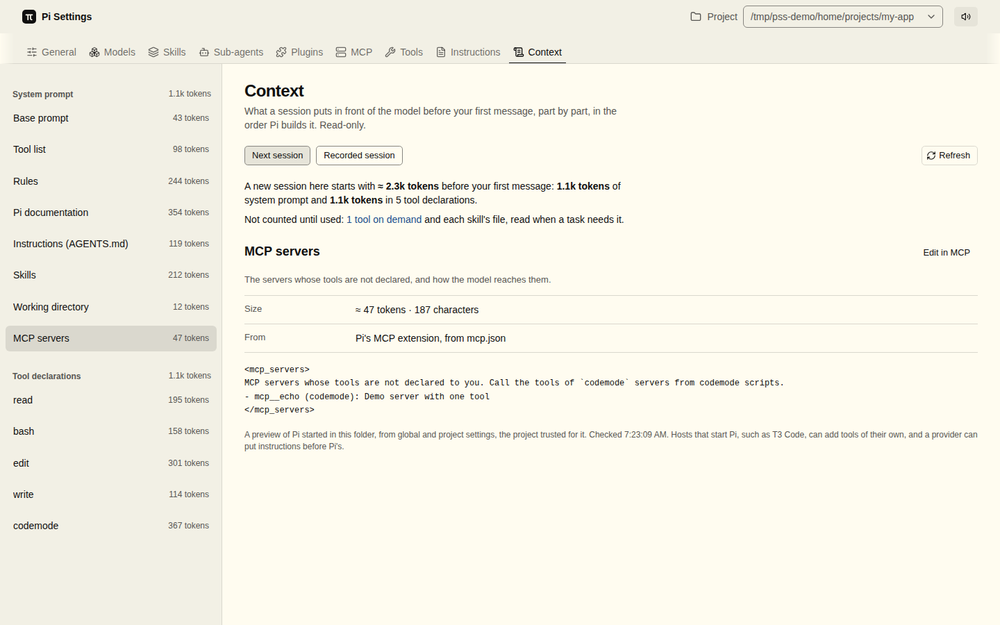

# Pi Settings Studio

A local GUI for [Pi](https://pi.dev) core configuration: MCP servers, models, skills, packages, and an inspector that shows what a new session puts in front of the model. Settings only, no chat. Inspired by the settings panel of [pi-web](https://github.com/agegr/pi-web). Unofficial: not affiliated with Earendil Works.

[Try the demo](https://pi-settings-studio-demo.khoaphamda.workers.dev) — no installation, sample data only. To edit your own settings, [run it locally](#run).



Native Pi files stay authoritative: the app reads and writes `settings.json`, `mcp.json`, `models.json`, skills and `AGENTS.md` in place, and keeps unknown keys. More screens: [Tools](docs/screenshots/tools.png), [MCP](docs/screenshots/mcp.png).

Scope, decisions and boundaries: [SPEC.md](SPEC.md). Coverage: [docs/parity.md](docs/parity.md). Progress: [tasks/todo.md](tasks/todo.md).

Third-party notices: [THIRD_PARTY_NOTICES.md](THIRD_PARTY_NOTICES.md).

## Demo

[Open the hosted demo](https://pi-settings-studio-demo.khoaphamda.workers.dev). It is read-only and cannot access your local Pi files.

For maintainers: [build, refresh and deploy the demo](docs/demo.md).

## Run

Requires [Bun](https://bun.sh) 1.4.2 or newer (tested on 1.4.2) and Pi, with `pi` on your `PATH`. Not on npm yet.

```sh
git clone https://github.com/Gohans1/pi-settings-studio
cd pi-settings-studio
bun install --frozen-lockfile
bun run build
bun run start            # http://localhost:4369
```

Options:
- `--port`: HTTP port (default: `4369`).
- `--agent-dir PATH`: Pi configuration folder (default: `PI_CODING_AGENT_DIR` or `~/.pi/agent`).
- `--project PATH`: add a project to the picker. Without it, projects are discovered from Pi sessions; the current directory is not added automatically.

Use a temporary `--agent-dir` while trying changes.

## Run in the background

Requires Linux with systemd, or WSL with systemd enabled. Before enabling the service, edit the copied unit: set `WorkingDirectory` to the repository's absolute path and replace `/usr/local/bin/bun` in `ExecStart` with the absolute path returned by `command -v bun`.

```sh
bun run build
mkdir -p ~/.config/systemd/user
cp service/pi-settings-studio.service ~/.config/systemd/user/
command -v bun
# Edit ~/.config/systemd/user/pi-settings-studio.service as described above.
systemctl --user daemon-reload
systemctl --user enable --now pi-settings-studio
loginctl enable-linger "$USER"   # start with WSL, without opening a terminal
```

Then bookmark `http://localhost:4369`. If startup fails, inspect the error with `journalctl --user -u pi-settings-studio -n 50`. After pulling changes: `bun run build && systemctl --user restart pi-settings-studio`.

To open it from a phone on your tailnet, run `tailscale serve --bg --https=4369 http://127.0.0.1:4369`, then start the service with `--allow-origin https://<machine>.<tailnet>.ts.net:4369` (a systemd drop-in keeps that out of the repo). The app has no login, so anyone on that tailnet who reaches it can change settings.

## Tabs

- **General**: the `settings.json` keys no other tab owns, raw JSON, keyboard shortcuts, the installed Pi version with Update Pi and a newer Pi on npm when there is one, and what cannot be edited here.
- **Models**: every provider of Pi's model runtime with its models (limits, image input, thinking levels, price), sign-in and key setup through Pi's own login, credential check, defaults with the thinking levels each model offers, enabled models as a checklist, prompt caching and thinking budgets, custom providers and changes to a shipped provider in `models.json`, with model lists from their endpoint.
- **Skills**: switches, whether the model may load a skill (one, or a whole group from its menu), a file editor for each skill folder, new skills, Remove with Undo, skill commands.
- **Sub-agents**: profiles in Pi's example format.
- **Plugins**: extensions, prompts and themes (switches, editor, new files), packages (check for updates, update notices, install, update, remove, filters, the npm command). Select an extension to inspect all registered tools and direct model declarations for the chosen project. Installed extensions are trusted and run automatically for this preview; see [Extension tools](docs/plugin-tools.md).
- **MCP**: servers with exposure rules, each server's state (connected, needs sign-in, failed) and tools as soon as the tab opens, OAuth and provider sign-in, Code mode, import from other clients, connection test, sign-in state, `mcp.log`.
- **Tools**: what the model sees and doesn't see in a new session, and every source it comes from (built into Pi, extensions, MCP servers), off ones included, with search. Startup tools turns Pi's own tools on or off. Runs the same trusted inspection as Plugins; see [Extension tools](docs/plugin-tools.md).
- **Instructions**: `AGENTS.md`, `SYSTEM.md`, `APPEND_SYSTEM.md`.
- **Context**: what a session puts in front of the model before the first message, part by part, each with Pi's token estimate, the file it comes from and the tab that changes it. Next session builds it with the trusted inspection Tools runs; Recorded session shows a session's first request and what Pi changed later.

The project picker adds each project's `.pi` files and trust. Changes apply to new Pi sessions, or after `/reload`.

Buttons that run something use the `pi` command on `PATH` (or `~/.local/bin/pi`) with `PI_CODING_AGENT_DIR` set to the app's agent directory.

## Package update notices

The app looks for package updates in the background, as Pi does at startup: when Plugins is listed and the last check for the current settings is missing or a day old. Pi's public checker reports which installed npm/Git packages have updates; matching rows say **Update available**, the Packages entry and the **Plugins** tab show the count. **Plugins → Packages → Check for updates** checks now. Checking does not install anything. **Update** and **Update all** still require a separate click.

The last result and timestamp are kept in `pi-settings-cache.json` beside Pi's files, so they survive reloads and restarts, and a check still running when you come back shows as checking. Settings changes and package operations invalidate those notices. A failed automatic check is not repeated within the hour. The newer Pi beside the installed one comes from `npm view` the same way, once a day; `PI_SKIP_VERSION_CHECK` turns that off. Select and trust a project to include its packages. Updates run from that project's directory when selected, following Pi's global/project rules.

The checker uses system `npm` and `git` (not `npmCommand` from settings), and Pi's existing version/range, pin and project-precedence rules. It skips local paths, exact npm pins, pinned Git refs, missing installations and failed lookups. `PI_OFFLINE` skips networking, and automatic checks with it. **“No updates reported” does not mean all packages are current:** Pi's API does not distinguish network/authentication failures or expose target version numbers. No extensions are loaded to perform the check.

## Security

- The server listens on `127.0.0.1` only, checks Host and Origin, rejects cross-site requests and has no login. Anyone who can reach it can change your Pi settings, so do not expose it beyond your machine (see the tailnet note above).
- Installed extensions are trusted, not sandboxed. Selecting an extension, or opening Tools or Context, loads extensions and connects configured MCP servers through Pi in a separate process. General and Models › Defaults also load enabled extensions in a provider-inspection process to read their model metadata. Extension code can access files and the network. [Extension inspection and side effects](docs/plugin-tools.md#trust-and-side-effects).
- Secrets stay on the server: `auth.json` values and MCP `env` / `headers` values are never sent to the browser.

## Test

```sh
bun test
bun run typecheck
bun run lint
bun run build && bun run test:e2e
```

## License

MIT, see [LICENSE](LICENSE). Third-party notices: [THIRD_PARTY_NOTICES.md](THIRD_PARTY_NOTICES.md).
